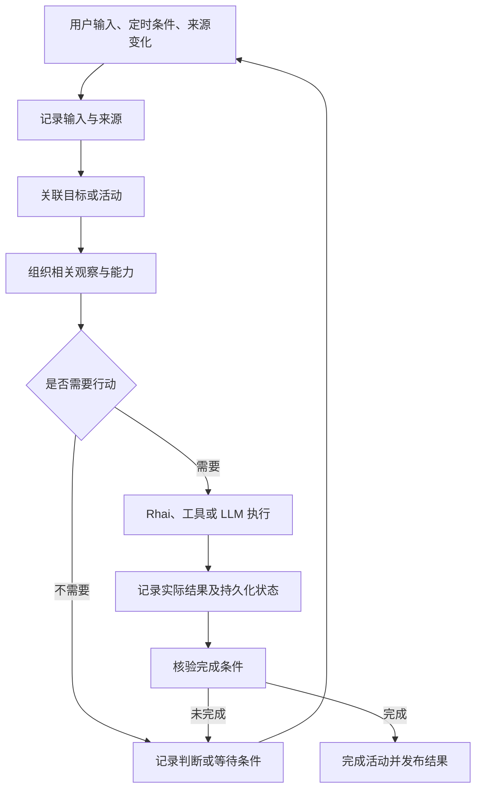

# Big Head 运行模型

日期：2026-09-19。状态：基于当前工作树的架构基线与后续设计，不代表后续接口已实现。

本文补充 [Definitions](definitions.md) 和 [Three-Cycle Roadmap](three-cycle-roadmap.md)：先解释现有系统如何运行、何处断开，再安排下一步。历史产品方案中的目标和验收勾选不能替代代码事实。本轮不迁移世界、不增加后台任务、不改动调度策略。

## 1. 系统要维持的是什么

Big Head 是一个由运行时管理的持久世界。Agent 通过观察理解世界，通过受约束的操作改变世界。LLM 是其中一种决策执行器，不等于整个运行时，也不需要持续调用才算系统在运行。

持续存在的应是目标、活动及其进度：现在关注谁，做到哪一步，等待什么变化，怎样验证结果。模型请求结束后，这些信息仍应可查询；重启后，系统应知道哪些可以继续、哪些需要核对、哪些已经结束。

ECS 是业务状态的主要载体，但当前不是所有对象的唯一物理存储位置。系统定义在 SystemRegistry，动态 schema 在组件注册表，观察队列在运行时并随 checkpoint 元数据保存。统一的是发现、身份和操作语义，不是强制把所有数据复制成组件。

## 2. 从 Linux 借鉴的边界

| 借鉴点 | Big Head 的对应原则 | 不作出的承诺 |
|---|---|---|
| 内核维持机制，程序执行业务 | runtime 管调度、交付、保存和能力边界；agent 决定业务含义 | 不把每条业务规则写死到 Rust |
| 对象有明确类型和操作入口 | schema、entity、system、activity 分别可发现、可描述、可操作 | ECS 查询不承担系统注册表查询 |
| 进程等待时仍有状态 | 活动可以等待用户、来源更新或定时条件，无需反复调用模型 | 暂不提供 OS 式抢占、隔离或公平调度 |
| 调用有返回结果和错误归属 | 区分模型 API、校验、脚本、持久化、交付失败 | 工具返回成功不等于业务目标完成 |
| 可检查系统而不运行任务 | 提供只读观察入口，显式报告缺失和过期 | 不靠试运行有副作用的 system 来发现它 |

这是一套运行时设计原则，不是重新实现 Linux，也不是把 prompt 当作内核。

## 3. 核心对象及其真实位置

下表“已有”只表示对应结构或路径存在，不代表所有业务都遵循了该模型。

| 对象 | 定义与身份 | 当前实现 / 缺口 |
|---|---|---|
| World | 独立运行、保存和引用的边界，使用 world_id | 已有 WorldManifest 和世界目录；不是多写者数据库 |
| Entity / Component | 对象及其组合状态 | 已有原生和动态组件；数值 eid 是当前运行实例的地址，恢复可改变 |
| Stable identity | 跨恢复识别同一逻辑来源 | 已有 RuntimeIdentity / source_id，尚未覆盖每个业务对象；未知关联不得猜测 |
| Schema | 组件名称、字段与类型约束 | 已有组件注册和动态校验；未定义组件不能直接 spawn |
| System | 可执行定义，使用 system id | 已有 SystemRegistry 与 RhaiScript / Llm；不是 RuntimeSystem 或 SystemScript 组件 |
| Tool / Rhai function | 某个执行环境允许调用的入口 | 已有工具白名单和 Rhai 注册函数；同名或相似名称不表示能力互通 |
| Spark | 进入 agent 队列的输入 | 已有 Spark、SparkDispatch、状态和恢复队列；不是完整目标或通用 Job |
| TickAction | 带 cooldown 的 Rhai 周期执行器 | 已有自动评估；last_run 是执行状态，不能单独证明业务产出 |
| Observation | 关于一次执行或来源的观察 | 已有 TickObservation、RuntimeEvent、Lens 回执；来源观察时间与内容更新时间应分开 |
| Goal / Activity | 想达到的状态，以及持续推进它的工作 | 尚无统一实现；现有动态 WorkItem、Spark、角色状态不能直接等同 |
| Action / Transaction | 一次操作，以及一组操作的审计关联 | 已有 ActionRecord / TransactionRecord；没有事务回滚或全世界变更捕获保证 |
| Lens | 组织观察的视角或跨世界交换对象 | 本地 LensApplication/Binding 与跨世界 Lens 协议已存在，两者不混用 |
| Shard | 大内容的存储及读取单元，按 paradigm 引用 | 已有投影、读取、引用和保留策略；有正文不等于已形成业务事实 |
| View / Interaction | 人可见的投影与输入 | 已有事件通道、面板快照、专用 CharacterDemo；尚无通用互动生命周期 |

拟议的统一引用形式是 `world_id + object_kind + stable_id`，需要时附加版本。它是设计方向，不是现有所有工具都接受的参数。系统 id、source_id、事件 sequence、action_id、interaction_id 各有作用，不互相替代。

## 4. 落地的数据不自动等于事实

| 含义 | 示例 | 应保留的信息 |
|---|---|---|
| 外部观察 | 某次天气查询返回下雨 | 来源、获取时间、来源更新时间、原始结果引用 |
| 运行事实 | 某脚本在某次调用返回错误 | 执行身份、关联事件、错误阶段、实际结果 |
| 派生判断 | agent 认为天气已经过期 | 支持它的观察与版本、判断时间、判断主体 |
| 用户意图 | 希望明早提醒带伞 | 请求来源、作用对象、完成条件 |
| 展示状态 | 页面显示“正在回应” | 对应活动、状态版本、当前是否连接 |

这些可以组合成业务组件，不要求给每个实体加一份庞大的通用 Fact schema。第一步是在需要追踪的活动和观察中明确语义、来源与版本，再提炼公共字段。未知来源或缺失时间必须可表示，不能用本次 Lens 读取时间伪装数据已更新。

## 5. 执行与持续活动

期望的逻辑循环如下；这是跨链路的目标模型，不是目前已经存在的一条统一管线。

不要把这张图实现成一个巨大的 `status` 枚举。至少要分开四个维度：

| 维度 | 要回答的问题 | 不等价的结果 |
|---|---|---|
| 执行 | 操作未开始、运行中、成功、失败或中断？ | 执行成功不等于结果已持久化 |
| 持久化 | 哪些状态已保存，哪些仅在内存，保存是否失败？ | 写内存不等于安全落盘 |
| 交付 | 输入已接收吗，观察事件已确认吗，页面已收到了吗？ | 服务端发布不等于浏览器已确认展示 |
| 业务验证 | 完成条件是否有证据支持，还是尚未核验？ | LLM 说“完成”不等于目标完成 |

后续 Activity 的最小设计应包含稳定 id、触发来源、目标引用、当前步骤、等待条件、恢复所需进度、执行引用和结果证据。等待条件必须能由具体触发器满足；恢复进度应是业务所需的数据，而不是要求保存模型内部思维。字段和 schema 尚未落地，先用下面两条链路确定它们的共同部分。

关键不变量：

1. 已成功写入、但回执校验失败时，重试先核对结果，不默认重做副作用。
2. 恢复后的 eid 变化不构成新对象；已有稳定身份优先。
3. 工具能力按执行环境描述：LLM tool 可调用不意味着 Rhai 内可调用。
4. 缺失、过期、截断、窗口丢失、保存失败都必须显式呈现，不能包装成成功或空结果。
5. 完成活动后才推进相应处理进度；仅看见一次变化不等于已处理它。
6. 不以增加实体数量、ActionRecord 数量或模型轮数作为系统有效运行的证明。

## 6. 两条现有链路的对照

### 角色互动：具体 demo 已成立

当前路径：`View greet/say -> interact_with_character -> CharacterDemo -> 专用无工具 LLM -> 保存 -> 发布面板`。

- interaction_id 关联输入和回复，最近 16 条记录提供有界去重。
- 本地发送与 runtime 的 thinking 状态分开；当前代码先发布 thinking，再保存接收记录，随后才调用模型。因此 thinking 表示内存接收，不保证此时保存已经完成。
- 正常最终回复先保存再发布；失败和重启中断有可见状态。
- `sync` 与面板快照支持重连恢复；尚无浏览器展示确认协议。
- 不经过 Spark，不使用通用 Activity，不具备角色自主任务调度。
- 浏览器动画只是表现，不是后台工作证据。16 条以外没有永久去重保证。

后续抽象的验收：相同互动不会在承诺的重试窗口内重复执行；接收、保存、回复、展示能分别检查；恢复不会无声重复调用或声称已经完成。保持现有 demo 可用，再逐项替换，不先迁移全部业务。

### TickAction 观察：执行与确认是两件事

当前路径：`evaluate_tick_actions -> Rhai -> TickActionReport -> 观察队列 -> lease -> tick-steward -> 校验 dispositions -> acknowledge / defer`。

- 调度器已经自动运行，不需要用户每次调用 run_system。
- source_id 与 correlation_id 提供来源和因果关联；恢复时 rebind 当前 eid。
- steward 可忽略、记录、修复或升级为工作项；写入必须有对应证据。
- 回执失败不撤销已有写入；失败批次缩小、退避重试，单事件持续失败仍可能阻塞队首。
- 队列有容量上限，满时丢最旧项并累计 dropped；不能称为无限期、无丢失交付。
- 当前 `reason` 无专属字数上限；事件唯一、理由非空、证据匹配仍需校验。
- 默认 100 轮是整个 steward 批次的模型推理预算，不是每个事件或 TickAction 的运行次数。

后续抽象的验收：一次脚本执行失败与一次观察确认失败能区分；重复交付不造成重复业务效果；发生窗口丢失时可发现缺口。不能用不断提高轮数代替这些语义。

## 7. 观察接口要成为系统入口

Agent 首先应能回答：世界里有哪些对象类型？当前执行环境能调用什么？这个对象的定义是什么？某项活动为什么还没结束？

已有入口包括 `query_entities`、`get_entity`、`inspect_world_shape`、`inspect_runtime`、`inspect_lens_apps`、`inspect_lens_bindings` 和 `inspect_shards`。它们各自有范围，不能互相代替：

- `query_entities` 查询实体组件；不能用猜测的 RuntimeSystem 组件查询注册表。
- `inspect_runtime` 观察交付事件和 Spark，不是系统源码目录；RuntimeJournal 只保留最近 1024 条事件。
- `after_sequence` 配合当前最新窗口查询不等于完整消费游标；现有实现从最新匹配事件中取 limit，不能保证逐页扫全中间事件。
- Lens 组织已有事实，不会因为重新读取就自动刷新外部来源。
- ActionRecord 能提供操作证据，但并非所有原生写入、Rhai 内部修改都有逐组件的审计记录。

第一项拟实现接口是只读的 **system 发现与描述**，工作名 `inspect_systems`：从真实 SystemRegistry 返回稳定 id、类型、定义及调用环境，列表与详情分离，长脚本提供明确分页。接口名称和参数是提案，尚不可调用。能力目录还应指出 Rhai 函数与 LLM 工具的区别，发现和读取不执行脚本。

## 8. 按依赖推进

| 顺序 | 要交付的内容 | 完成判据 |
|---|---|---|
| 1. 对象发现 | system 只读目录/详情，执行环境说明，针对错误命名的恢复提示 | 不创建伪组件、不试运行，agent 能确认 status_pulse_refresh 是否存在及如何调用 |
| 2. 活动对照 | 用角色互动与 steward 各形成一份可查询的阶段记录，复用已有身份和审计引用 | 能区分执行、保存、确认、验证；重启与失败场景无歧义 |
| 3. 最小公共契约 | 依据两条链路提炼 Activity 与结果结构，再与 roadmap 的 Job 对齐 | 一个具体活动能等待、继续、失败重试和结束；不强迁移旧数据 |
| 4. 有选择的持续观察 | 按关注对象及版本生成变化输入，记录可恢复进度 | 无变化时不反复推理；有缺口时报告而不是跳过；不做全世界快照 diff |
| 5. View 通用接入 | 从已验证互动提取事件、结果路由和展示确认 | 第二种面板复用契约，角色 demo 行为保持一致 |

本轮完成的是架构基线，不代表上述五项已完成。当前不启动通用订阅引擎、多 agent 调度、任意 Rhai 嵌套 system 执行或全量业务迁移。是否允许嵌套执行应同时考虑重入、递归、权限和审计归属，不靠简单注册一个同名函数补齐。

## 9. 代码与文档依据

| 依据 | 主要核对内容 |
|---|---|
| [execution.rs](../crates/big-head-ecs/src/execution.rs) | RuntimeIdentity、SparkDispatch、RuntimeJournal、恢复关联 |
| [system_def.rs](../crates/big-head-ecs/src/system_def.rs) | system 是注册表定义，Rhai 与 LLM 类型 |
| [scripting.rs](../crates/big-head-script/src/scripting.rs) / [run_system.rs](../crates/big-head-loop/src/tools/run_system.rs) | Rhai 注册函数与 LLM 工具边界 |
| [runtime.rs](../crates/big-head-loop/src/runtime.rs) / [main.rs](../src/main.rs) | 自动 tick、观察处理、串行运行与交接 |
| [observation.rs](../crates/big-head-loop/src/observation.rs) / [steward.rs](../crates/big-head-loop/src/steward.rs) | 有界队列、重试、回执校验 |
| [audit.rs](../crates/big-head-loop/src/audit.rs) | 审计分组与操作记录，不提供回滚 |
| [inspect_runtime.rs](../crates/big-head-loop/src/tools/inspect_runtime.rs) | 查询范围与最新窗口语义 |
| [character_demo.rs](../crates/big-head-loop/src/character_demo.rs) / [Character Demo](../docs/character-demo.md) | 独立互动、去重窗口、持久化与发布顺序 |
| [Checkpoint Lifecycle](../docs/checkpoint-lifecycle.md) | manifest、blob、journal、单写者边界与回收 |
| [本地 Lens](../docs/lens-applications.md) / [跨世界 Lens](../docs/lens-world-protocol.md) | 观察、来源版本与跨世界边界 |
| [Ambient Dwelling](../docs/specs/ambient-dwelling-mvp-spec.md) | 产品动机与早期设计；不作为实现状态证明 |
