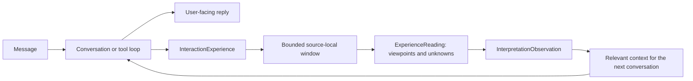

# Interaction Experience Loop

Normal conversation and internal continuity now have different lifetimes. A foreground Spark can reply without tools. A completed or failed transaction then records one `InteractionExperience`: stable Spark source ids, transaction id, source scope, outcome, bounded request/reply/Lens excerpts, sampled tool inputs and results, and interpretation result references. This is evidence of what was said and returned; it is not an independently verified FactRecord.

The visible reply, rather than the operator's internal report, becomes the Spark's conversation history. TransactionRecord still retains the operator report. Explicit work continues through the existing tool loop; conversational reflections can take the direct path. Both paths record experiences.

## Bounded Conversation Feedback

Direct conversations with a recalled observation now run one tool-free comparison of the draft against current speaker messages, same-conversation history and the derived observation. An explicit discrepancy permits a replacement; an unchanged reply remains unchanged. The delivered response and persisted experience use the same replacement. A separate `llm_system:conversation-feedback` transaction records issues and whether the draft changed. This is a model comparison, not independent verification of external facts. It can still make semantic mistakes.

The check has a 20-second timeout and a 64 KiB input ceiling. Failure is audited and retains the draft; it does not retry or block indefinitely. This adds one model call to direct conversations that recall an observation. Tool-loop receipts do not go through this new check.

Current messages are repeated after recalled context with explicit source boundaries. A2A direct chat no longer automatically runs local coordinator Lens bindings, and the automatically recalled first peer message must belong to the same conversation. Explicit message references can still retrieve another conversation from the same claimed peer.

Observation validation failures record the field/index, relevant constraint and a bounded rejected-output excerpt in the failed transaction. Observation instructions preserve the first announcement of a change, the reply that missed it, and the later correction, rather than treating eventual agreement as evidence that the first reply was correct.

Live MiniMax probes on 2026-09-30 confirmed correction of a stale project decision and preservation of the first missed change in a later observation. A combined decision/location probe still produced first-person attribution drift in a replacement despite instructions; it remains an explicitly ignored live regression probe, not a passing source-isolation guarantee. Source filtering at context assembly is therefore essential. Model feedback is best-effort and does not establish a universally reliable semantic guard.

## Window and Feedback

`BIGHEAD_INTERPRETATION_WINDOW_SIZE` remains optional, default 2, range 1..60. In an experience stream it counts interactions, not individual tool calls, tokens or rendered game frames. A 30-call investigation does not create 30 equivalent experiences. Existing interpretation-only streams retain their prior counting rules.

When idle, the runtime starts at most one detached, tool-free model request. It uses the configured provider/model on an independent request queue and emits no foreground agent UI events. Each experience gets one or two tentative viewpoint readings; the same request then compares them into an observation. JSON validation requires exact input ids, complete coverage, bounded readings, and no duplicate viewpoints. Invalid output leaves the window pending without partial records. Timeout is 45 seconds; retry delay is five minutes.

The worker owns a snapshot, never ECS. The main thread checks the pending window and preceding observation before committing readings and observation together. New experiences may append during inference. Another changed predecessor invalidates the result. Cancellation or world restore aborts the worker; pending input persists for retry. Observations do not enqueue Sparks or recursively record themselves as experiences.

Local-user, each claimed A2A peer/conversation pair, and background sources have distinct scopes. A2A identity remains unauthenticated. Project isolation is not inferred from prose: local conversation may discuss multiple projects, and the model must preserve their distinctions. This is not an automatic 30-project scheduler.

The latest observation in the same scope is injected into subsequent conversation as revisable, untrusted context. Current corrections take precedence. The background pass never silently upgrades a statement or its own interpretation into a user preference or verified fact. Existing `record_fact` and `record_interpretation` remain available for explicit modeling tasks.

Each new experience's `prior_observation_id` records the observation actually supplied to that turn. This permits checking the feedback path without inferring recall from the model's wording.

## Inspection and Limits

`inspect_interpretations` reports experiences and pending experience counts. Pass `experience_id` for the bounded evidence bundle, or `observation_id` for its input experience and reading ids. `ExperienceReading` is queryable as an ECS component; `inspect_transaction` locates the original transaction audit. Runtime-owned experience and reading records cannot be rewritten through generic agent CRUD tools.

Excerpts are marked when truncated; original Spark/transaction references remain attached. Observation input is bounded and is not proof of exhaustive reading. Summaries may still misinterpret a speaker: source tracking and validation check structural provenance, not semantic truth. The foreground intent heuristic is deliberately small and may misclassify mixed requests. Neither a recorded observation nor a passing test proves that the agent now understands every user or project.

## Live Validation

On 2026-09-30 an isolated MiniMax/A2A world, `codex-experience-smoke-20260930`, completed four simulated conversational turns with zero tool calls. It persisted four experiences, six viewpoint readings and two observations, with no FactRecord. After restarting that test world, the fourth experience recorded the first observation's id as prior context; the second observation linked to the first and identified the correction from assuming existing employment to the speaker actually being in a job search. Both observations preserved the simulation qualification. The isolated process was shut down normally; the user's live world was not used for these synthetic records. This verifies the recording, interpretation, observation, restore and feedback path; some model paraphrases still over-infer personal circumstances.
